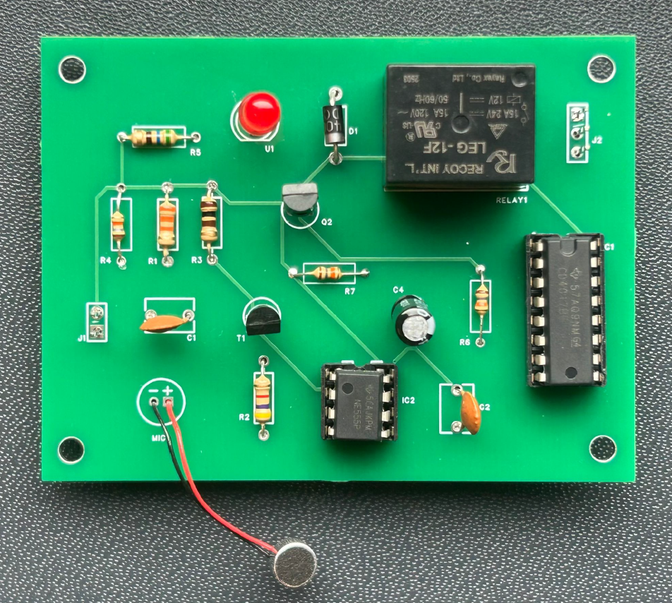
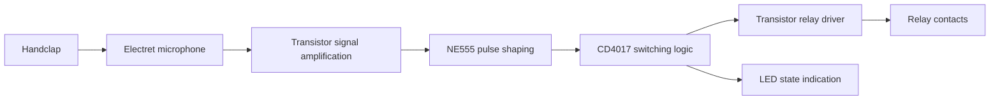
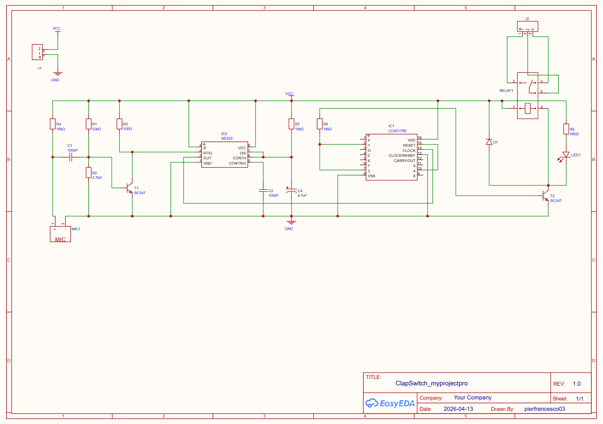
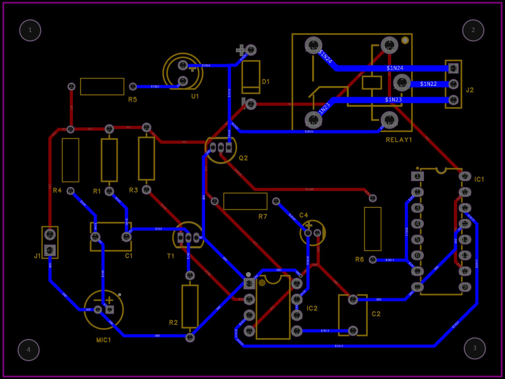
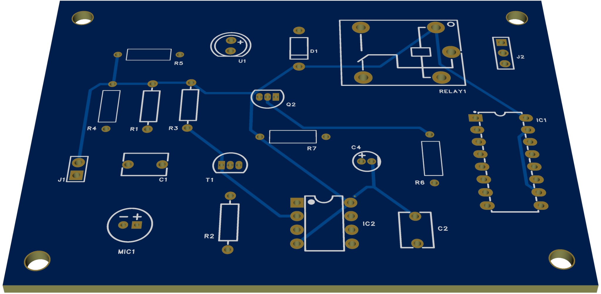

# Clap-Activated Switch — PCB Design, Fabrication & Hardware Testing

**An end-to-end electronics project developed at Lodz University of Technology, from a practical need to a fabricated and laboratory-tested PCB.**



## Motivation and objective

While living in a university residence, I noticed that the room's light switch was inconveniently positioned away from the bed. This inspired a hands-free electronic switching prototype controlled by the sound of a handclap. I developed the board during the **Equipment Design and Material Engineering** course at **Lodz University of Technology**.

The goal was to demonstrate an acoustic-triggered **relay state toggle with an LED status indicator**. This is an educational, low-voltage-tested prototype, **not a device installed on a building's mains lighting circuit**.

## How it works



The circuit uses an electret microphone, **BC547** transistors, an **NE555** timer, a **CD4017** counter and a **12 V relay**. The functional architecture was reconstructed and adapted in EasyEDA from an existing Electronics Hub reference described in the report; I do not claim to have invented the underlying clap-switch circuit topology.

## Engineering workflow

### Schematic design and component selection

I analyzed the functional requirements, reproduced and adapted the circuit in **EasyEDA Pro**, selected available through-hole components, and compared package drawings and datasheets with PCB footprints. In parallel coursework, I also explored **KiCad** and **Altium Designer** for a *separate multivibrator exercise*; this particular board was developed in EasyEDA.



### PCB layout and fabrication

I placed the through-hole footprints, routed the board using **top and bottom copper layers**, and prepared manufacturing files. The report records 0.5 mm traces for most connections and 1 mm for the relay-output routes, plus four board mounting holes.





**Five FR-4 prototype PCBs were ordered from JLCPCB.** The [`manufacturing` folder](manufacturing/) contains the **Gerber/drill ZIP recovered from that fabrication order** (not a newer regenerated export), while [`hardware`](hardware/) contains the editable **EasyEDA Pro `.epro2` project export**.

### Manual assembly and functional verification

I populated and hand-soldered the through-hole PCB and used DIP sockets for the two ICs. Laboratory testing was performed using an **AXIOMET AX-3005D DC bench supply at approximately 10.3 V**, as documented in the course report.

Handclaps successfully toggled the relay. During initial testing, the relay switched but the LED remained off; after investigating and reversing the LED's orientation, the indicator correctly followed the switching state. The resulting prototype met the intended laboratory functional objective. No acoustic detection range, false-trigger rate, long-term reliability or mains electrical safety certification was measured.

## Results at a glance

| Stage | Documented result |
| --- | --- |
| CAD | Schematic and two-layer PCB designed in EasyEDA |
| Fabrication | Five PCB prototypes ordered from JLCPCB |
| Assembly | Through-hole components hand-soldered and inspected |
| Verification | Acoustic trigger changed relay state and LED indicator state |
| Troubleshooting | LED orientation issue detected and corrected during testing |

## CAD BOM versus as-built components

The BOM exported from EasyEDA contains **16 component groups (20 component placements)**. It represents the **CAD/library selections** and must not be interpreted as a verified purchasing list for every manufacturer part number.

Two component details are worth documenting explicitly:

- **R2:** **4.7 kΩ** was fitted to the prototype; the current schematic and BOM both show 4.7 kΩ. A previously cached PCB property displayed 4.64 kΩ, an earlier nominal value.
- **D1:** the schematic and exported CAD BOM identify a **1N4004**. A **1N4007** from the same rectifier family was fitted in the physical prototype, as documented in the report and confirmed by the builder.

See [`bom/EasyEDA_BOM_2026-10-22.xlsx`](bom/EasyEDA_BOM_2026-10-22.xlsx) for the untouched export and [`bom/components-from-CAD-BOM.csv`](bom/components-from-CAD-BOM.csv) for a readable inventory with assembly notes. Footprint and vendor part numbers in the BOM are CAD metadata, not proof of the precise parts installed.

## Repository files

```text
Clap-Switch-PCB-Design/
├── README.md
├── hardware/
│   ├── ClapSwitch_myprojectpro_2026-10-22.epro2
│   └── README.md
├── manufacturing/
│   ├── Gerber_PCB4_2026-05-09_original-JLCPCB-order.zip
│   └── README.md
├── bom/
│   ├── EasyEDA_BOM_2026-10-22.xlsx
│   ├── components-from-CAD-BOM.csv
│   └── README.md
├── images/
│   ├── assembled-pcb.png
│   ├── pcb-layout.png
│   ├── pcb-3d-view.png
│   └── circuit-schematic.png
├── testing/
│   └── lab-test-summary.md
└── docs/
    ├── clap-switch-technical-report-public.pdf
    └── design-revision-notes.md
```

**Revision note:** The Gerbers are the manufacturing snapshot from **May 2026**, while the editable EasyEDA project and BOM were exported in **October 2026**. A later EasyEDA DRC check reported a schematic–PCB netlist/property synchronization warning. These two snapshots have **not** been formally demonstrated to be identical revisions. For details, see [`docs/design-revision-notes.md`](docs/design-revision-notes.md). Use the original fabrication Gerbers to inspect the *as-ordered* board.

## Project scope and attribution

- **Academic context:** Equipment Design and Material Engineering, Lodz University of Technology
- **Tools:** EasyEDA Pro; JLCPCB; component datasheets and supplier catalogues
- **Technical report:** [`docs/clap-switch-technical-report-public.pdf`](docs/clap-switch-technical-report-public.pdf) (student identifier removed)
- **Reference circuit:** General clap-switch architecture adapted from an Electronics Hub reference, acknowledged in the original report (exact link to be added only if verified)

**Safety:** This project demonstrates low-voltage laboratory switching only. The materials do not establish electrical safety for direct connection to mains, or conformance with applicable product safety requirements. Do not connect mains voltage based solely on this design.

No open-source reuse license has been assigned in this repository.
